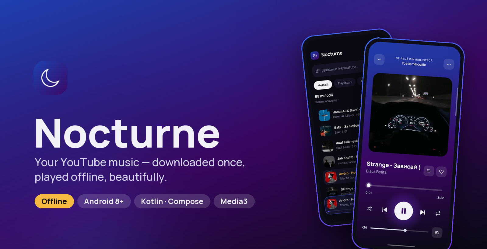
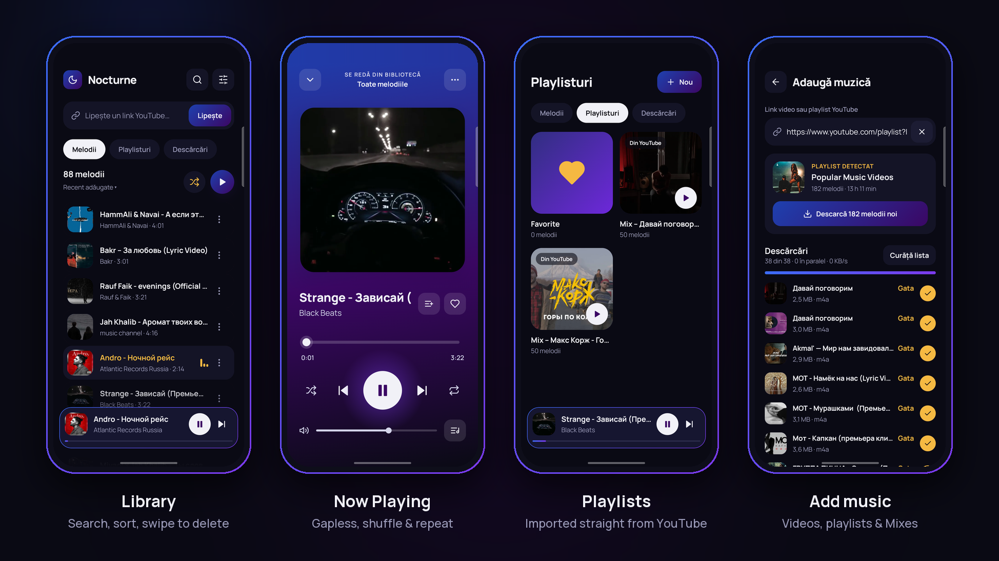
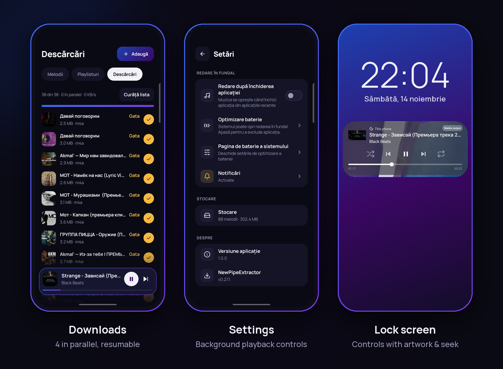

<div align="center">



<br>

<a href="https://github.com/cr37u/nocturne/releases/latest"></a>
&nbsp;

&nbsp;

&nbsp;
<a href="LICENSE"></a>

<br><br>

**Paste a YouTube link. Nocturne downloads the audio once and plays it offline,**<br>
**with the screen off, from the lock screen, or over Bluetooth. No account, no API key, no servers.**

<br>

<a href="https://github.com/cr37u/nocturne-desktop"></a>

</div>

<br>

<p align="center">
  
</p>

## Highlights

<table>
<tr>
<td width="50%" valign="top">

### Add anything from YouTube
Single videos, whole playlists (every page) and YouTube Mixes. Paste the link,
use **Share → Nocturne** from the YouTube app, or let Nocturne pick up a link
you just copied.

</td>
<td width="50%" valign="top">

### Fast, resumable downloads
Best audio-only stream (m4a/AAC, no FFmpeg). Four tracks in parallel, chunked
range requests, three retries, duplicates skipped. Downloads keep going after
you leave the app.

</td>
</tr>
<tr>
<td width="50%" valign="top">

### Real background playback
Built on Media3: a notification mini-player, lock-screen and Bluetooth controls,
audio focus handling, gapless auto-advance, and resume right where you stopped,
even after a reboot.

</td>
<td width="50%" valign="top">

### Your library, organised
Search, sort, swipe to delete, favorites, local playlists, and a draggable queue.
Imported YouTube playlists stay linked as <em>Din YouTube</em> playlists.

</td>
</tr>
</table>

<p align="center">
  
</p>

## Download

Grab the latest **`nocturne-vX.Y.Z.apk`** from [Releases](https://github.com/cr37u/nocturne/releases/latest) and open it on your phone.
You may need to allow installing apps from this source. Requires Android 8.0 or newer.

Releases are signed with this certificate:

```
SHA-256  ce:54:cd:36:5f:7c:f6:d4:f4:9d:bb:c9:c7:11:32:9f:ae:54:87:9d:13:fd:f1:48:90:2b:af:25:b6:f4:90:8e
```

> [!TIP]
> On Samsung, Xiaomi and other aggressive battery savers, open **Setări → Optimizare baterie** once,
> so music isn't stopped while the screen is off.

The interface is in Romanian.

## Nocturne on your computer

The same player exists for **Windows and Linux**: same design, same YouTube links, everything offline, plus media keys,
a tray icon, a desktop widget, a mini player and a Windows 11 Widgets board card.
Get it from [cr37u/nocturne-desktop](https://github.com/cr37u/nocturne-desktop) →
[latest release](https://github.com/cr37u/nocturne-desktop/releases/latest) (installer, portable zip or MSIX).

<p align="center">
  <a href="https://github.com/cr37u/nocturne-desktop"></a>
</p>

## Under the hood

| | |
|---|---|
| **UI** | Kotlin, Jetpack Compose (Material 3), Manrope |
| **Playback** | AndroidX Media3: ExoPlayer, `MediaLibraryService`, `MediaController` |
| **Extraction** | [NewPipeExtractor](https://github.com/TeamNewPipe/NewPipeExtractor) |
| **Downloads** | OkHttp range requests, Coroutines, WorkManager (foreground) |
| **Storage** | Room; audio in `Android/data/<package>/files/music` |
| **Architecture** | MVVM, `StateFlow`, Hilt |

<details>
<summary><b>How playback works</b></summary>
<br>

- Playback lives in `PlaybackService`, a Media3 `MediaLibraryService` with `foregroundServiceType="mediaPlayback"`.
  It doesn't depend on the Activity.
- ExoPlayer handles audio focus (it pauses for calls and ducks for notifications), pauses when headphones are unplugged,
  and holds a wake lock only while playing.
- The MediaStyle notification has artwork and shuffle · previous · play/pause · next · repeat, colorized in the
  app's tones. The lock screen and the Android 13+ media carousel come from the same session.
- Queue, position, shuffle and repeat are saved continuously. `onPlaybackResumption` lets a Bluetooth play button or
  the system media card resume after the process was killed.
- Closing the app from recents stops playback by default. **Setări → Redare după închiderea aplicației** keeps it playing.

</details>

<details>
<summary><b>Project layout</b></summary>
<br>

```
app/src/main/java/com/nocturne/player/
├── data/        Room entities and DAOs, repositories, preferences
├── youtube/     link parsing, NewPipe downloader, resolver, error mapping
├── download/    download queue, worker, progress notification
├── playback/    PlaybackService, notification provider, MediaController bridge
└── ui/
    ├── theme/       NocturneTheme (Color, Type, Shape)
    ├── components/  MiniPlayer, TrackRow, DownloadRow, PlaylistCard, …
    └── screens/     Library, Now Playing, Add music, Playlists, Settings
```

</details>

## Building from source

You need JDK 17 and the Android SDK (platform 35). The Gradle wrapper does the rest.

```bash
git clone https://github.com/cr37u/nocturne.git && cd nocturne
echo "sdk.dir=/path/to/Android/sdk" > local.properties

./gradlew assembleDebug        # debug build (separate app id: com.nocturne.player.debug)
./gradlew assembleRelease      # minified release build
./gradlew testDebugUnitTest    # unit tests + live YouTube extraction check
```

<details>
<summary><b>Signing a release</b></summary>
<br>

Without a keystore, `assembleRelease` signs with the debug key. To use your own key, create one and add
`keystore.properties` in the project root. Both files are git-ignored.

```bash
keytool -genkeypair -v -keystore nocturne-release.jks -alias nocturne -keyalg RSA -keysize 4096 -validity 10000
```

```properties
storeFile=nocturne-release.jks
storePassword=…
keyAlias=nocturne
keyPassword=…
```

Every update has to be signed with the same key. Keep a backup of both files.

</details>

<details>
<summary><b>Updating the YouTube extractor</b></summary>
<br>

When YouTube changes something and downloads stop working, the fix is usually a newer NewPipeExtractor.
The version is set on a single line in `gradle/libs.versions.toml`:

```toml
newpipeExtractor = "v0.27.1"
```

Bump it to the latest [release](https://github.com/TeamNewPipe/NewPipeExtractor/releases) and run
`./gradlew testDebugUnitTest`. The live test resolves a real video, playlist and Mix and downloads a sample.
The version in use is shown in **Setări → Despre**.

</details>

A full on-device test checklist lives in [docs/TESTING.md](docs/TESTING.md).

## Disclaimer

Nocturne isn't affiliated with YouTube or Google. Only download content you have the right to download,
and respect YouTube's Terms of Service and the copyright laws where you live.

## License

Released under the [GNU General Public License v3.0](LICENSE).
Nocturne uses [NewPipeExtractor](https://github.com/TeamNewPipe/NewPipeExtractor) (GPL-3.0) and the
[Manrope](https://github.com/googlefonts/manrope) typeface (SIL OFL 1.1).
